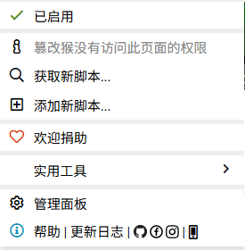
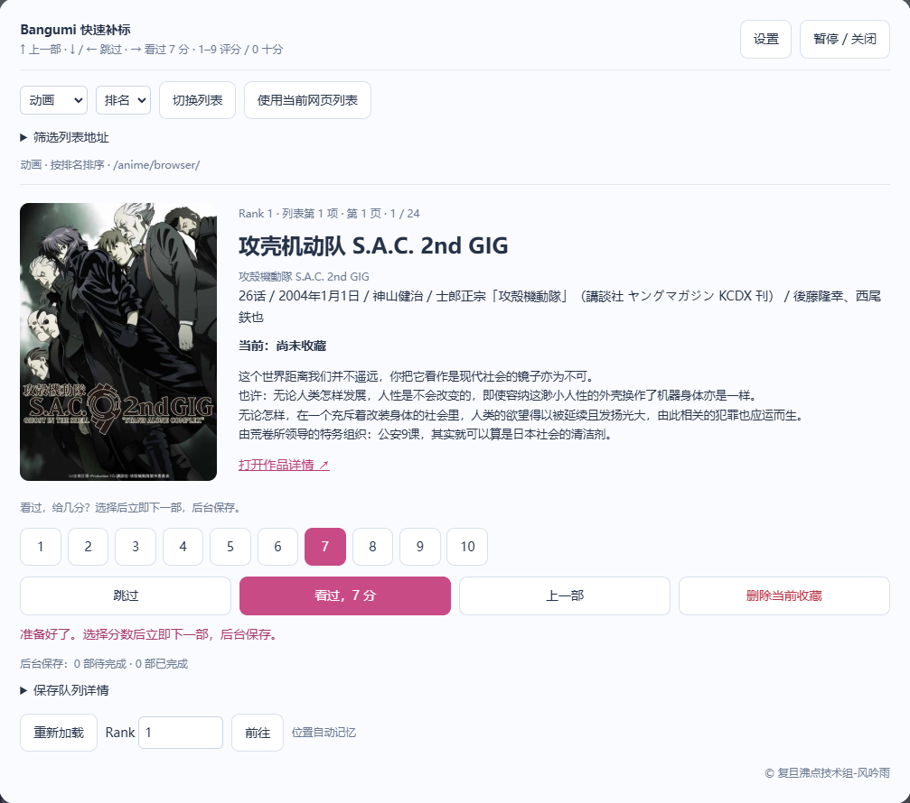
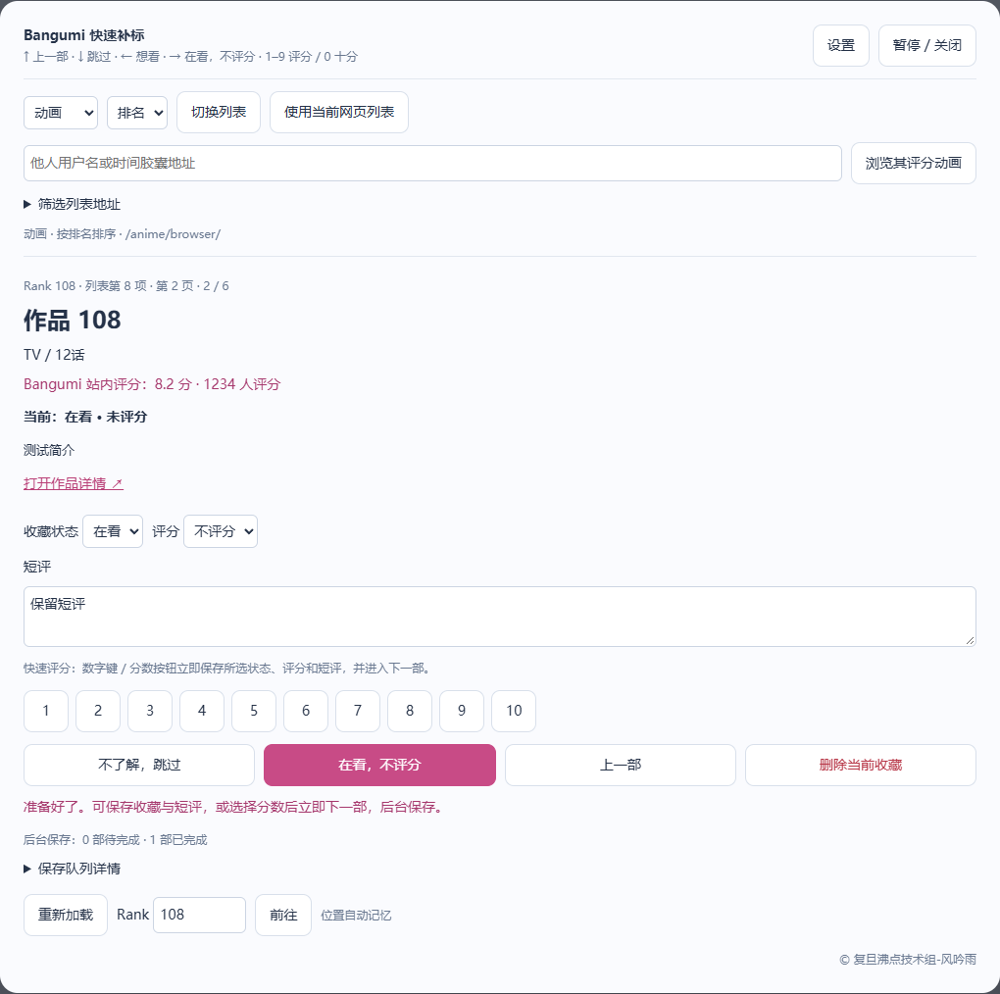
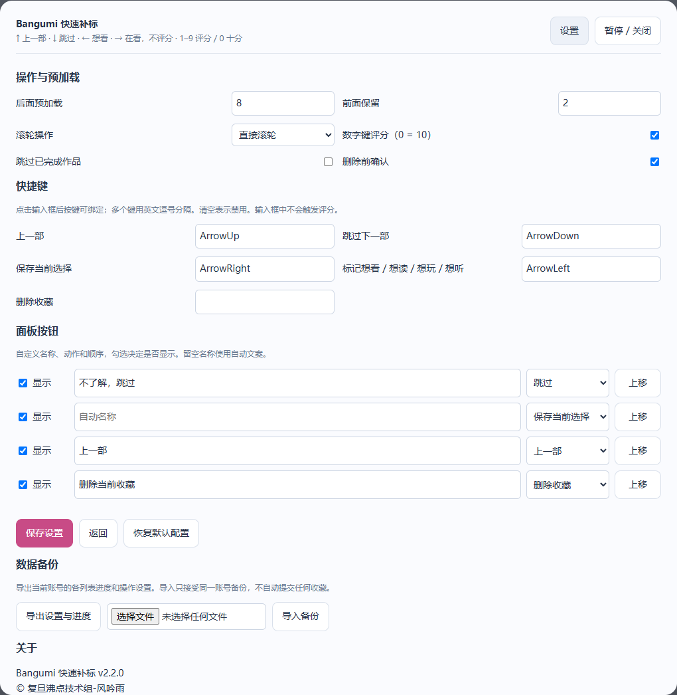

# Bangumi 快速补标

沿列表顺序浏览动画、漫画、书籍、游戏、音乐和三次元作品，用键盘、鼠标按钮或滚轮补全收藏。

## 安装

**推荐：下载脚本 → 油猴导入。无需 Node.js，无需启动服务器。**

### 1. 安装油猴

从 [Tampermonkey 官网](https://www.tampermonkey.net/index.php) 选择自己的浏览器并安装扩展。也支持 Violentmonkey，下面以 Tampermonkey 为例。

安装完成后，点击浏览器右上角的扩展图标，找到 Tampermonkey（篡改猴），进入 **管理面板**。



### 2. 导入脚本

1. **[点击下载 bangumi-quick-mark.user.js](https://github.com/LimitedMouse/bangumi-quick-mark/releases/latest/download/bangumi-quick-mark.user.js)**，保留 `.user.js` 后缀。也可尝试 [直接安装](https://raw.githubusercontent.com/LimitedMouse/bangumi-quick-mark/main/bangumi-quick-mark.user.js)，由管理器接管安装。
2. 在油猴管理面板顶部点击 **实用工具**。
3. 在 **导入 / 从文件导入** 区域点击 **选择文件**，选中刚下载的脚本。
4. 若出现脚本预览或安装确认页，点击 **安装**。
5. 回到 **已安装脚本**，确认 **Bangumi 快速补标** 的开关已开启。

不同版本的管理器文字可能略有差别，关键路径是 **管理面板 → 实用工具 → 从文件导入**。

### 3. 打开 Bangumi

登录 [bgm.tv](https://bgm.tv/)、[bangumi.tv](https://bangumi.tv/) 或 [chii.in](https://chii.in/)，刷新页面，然后点击右下角的 **快速补标**。


打开后即可顺着列表补标，快速填格子，成为老资历。



### 点击脚本链接后只显示源代码？

这不影响安装。用页面的下载按钮或 `Ctrl+S` 保存为 `bangumi-quick-mark.user.js`，再按上面的“从文件导入”操作。不要把文件保存为 `.txt` 或 `.html`。

也可直接复制源码：`Ctrl+A` → `Ctrl+C`，打开油猴的 **添加新脚本**，在编辑区全选替换为复制的内容，按 `Ctrl+S` 保存。

### 安装后看不到按钮？

- 确认管理器和脚本都已启用，并允许扩展访问当前 Bangumi 域名。
- Chrome 打开 `chrome://extensions/`，Edge 打开 `edge://extensions/`，进入 Tampermonkey **详细信息**，开启 **允许运行用户脚本**（如果有）。
- 较旧浏览器没有该开关时，按管理器提示开启扩展页的 **开发者模式**。
- 最后刷新 Bangumi 页面。输入法、广告拦截器或其他脚本有冲突时，可先暂时关闭相关扩展排查。

`npm run serve` 只供开发者预览本地安装页，普通用户不需要运行。

## 默认操作



| 操作 | 行为 |
|---|---|
| ↑ | 上一部，支持跨页 |
| ↓ | 跳过下一部，不改收藏 |
| ← | 标记想看（想读 / 想玩 / 想听）并下一部，按当前评分选择保存 |
| → | 保存面板所选收藏状态、评分和短评并下一部；默认不评分 |
| 1–9 / 小键盘 | 给对应分数并下一部 |
| 0 / 小键盘 0 | 给 10 分并下一部 |
| 点击分数 | 按所选状态，给指定分数并保存短评、下一部 |
| 底部保存按钮 / Ctrl + Enter（编辑区内） | 保存收藏状态、所选评分和短评；不强制使用默认分 |
| 删除当前收藏 | 删除收藏及评分，停留当前作品；默认确认 |
| Esc | 取消确认、返回设置前页面或关闭面板 |

作品面板显示 Bangumi 站内平均评分及评分人数，与个人评分分开显示；暂无评分或加载失败时会提示。

收藏状态可选「想看、看过、在看、搁置、抛弃」，书籍、游戏、音乐分别使用「读」「玩」「听」。未收藏作品初始选择完成状态，已收藏作品沿用原状态。评分只有一个「不评分」选项：未评分作品不写入分数，已有评分保持不变。未评分作品点击底部保存按钮或按 →即可只标记看过；选择 1–10 分可与状态、短评一起提交。底部主按钮和快捷键提示随当前状态、评分选择同步更新。数字键和分数按钮仍会立即写入对应分数。

短评直接在面板填写或编辑，支持多行；清空后保存会删除原短评。在状态、评分或短评编辑区按 `Ctrl + Enter`（macOS 可用 `⌘ + Enter`）即可保存并下一部。编辑区内普通数字、方向键不会触发补标。跳过、返回、关闭或刷新会保留未提交草稿，下次回到该作品继续编辑；草稿不会自动提交。

设置可修改快捷键、按钮名称/动作/顺序/可见性、预加载数量、跳过已完成作品及删除确认。



滚轮默认关闭，可选择直接滚轮或 Alt + 滚轮。向下跳过，向上返回，不会评分。旧版默认键位自动迁移为 ← 想看、↓ 跳过；已有自定义键位保留，旧默认分不再自动套用。

内置惯性抑制，简介区仍正常滚动。输入框、设置面板和输入法组合输入不会评分，长按按键不会连发。

## 列表与位置

支持五类作品的排名、热度、收藏、日期、名称排序；漫画使用书籍漫画子分类。可使用当前分类浏览页或粘贴地址保留筛选。

也可在面板的“他人用户名或时间胶囊地址”输入 Bangumi 用户名或完整时间胶囊网址，点击“浏览其评分动画”。工具按对方收藏动态的时间顺序逐部展示已评分的动画；其他类别和未评分作品会跳过。时间胶囊单独记忆位置，可跨页浏览；此来源不使用 Rank 跳转。

- 排名排序按具体 **Rank** 跳转；其他排序按 **列表第 N 项** 跳转。
- 每个账号、分类、排序、筛选组合分别记忆位置，自动翻页。
- 重开后恢复上次作品；榜单变动时尝试在相邻页找回作品，否则恢复邻近位置并提示。
- 默认后面预加载 8 部、前面保留 2 部，可在设置中修改。
- 1.x 旧版动画排行榜进度自动迁移。

## 保存、删除和纠错

先记录本地队列，再前进，后台提交网站原生表单并核对结果。提交前重新读取网站表单，只替换明确修改的收藏状态、评分、短评，保留未修改字段及最新的标签、隐私；删除与网站行为一致，会移除该收藏的评分、标签、短评。

误标后按 ↑ 返回，点击“删除当前收藏”。评分尚未完成时删除也会按序处理，最终采用最后一次操作。同一作品连续编辑会合并尚未完成任务中的字段，保留前次选择的短评和评分。可直接重新评分，无需先删除。

面板显示待完成、成功和失败，失败可以重试或放弃。重试先核对网站状态。同域名多个标签页协调写入，避免旧评分覆盖新选择；写入前检查当前账号。

关闭面板继续保存；关闭网页后无法继续请求，下次打开核对并恢复未完成任务。退出前可等待“0 部待完成”。

## 数据管理

正式用户脚本通过管理器存储共享三个支持域名的设置和进度。待提交队列和未提交草稿按账号及域名隔离，请在原域名处理未完成队列。调试注入回退到当前域名 localStorage。

不同浏览器/管理器不共享存储；清除脚本数据会丢失进度、草稿和待提交任务。设置提供导入导出，只接受同账号备份，不包含登录凭据、短评草稿或提交队列，不会因导入自动提交收藏。参见 [隐私说明](PRIVACY.md)。

## 开发与发布

需要 Node.js 20+，无 npm 运行依赖。

```text
npm run build     # 构建单个 .user.js
npm run check     # 源码与用户脚本语法、构建产物及安装页版本检查
npm test          # 核心逻辑与浏览器回归测试，自动管理测试会话
npm run test:unit # 仅运行核心逻辑测试
npm run package  # 生成 .local/release/ 安装包与源码快照
npm run serve    # 本地安装页
```

核心逻辑测试使用 Node.js 内置测试工具；浏览器测试通过 Playwright CLI 自动启动独立会话，用全新浏览器上下文隔离核心场景，并保留完整操作流程回归。首次运行需要联网获取 Playwright CLI 及可用的浏览器。全部站点请求被模拟，不修改真实收藏；日志和截图写入 `.local/test/`。

源码模块：config（配置）、storage（存储与旧数据转换）、editor（收藏编辑状态）、site（站点与缓存）、queue（队列）、ui（界面）、app（流程与交互）。修改源码后构建，不直接编辑生成脚本。版本只修改 `package.json`，构建自动同步脚本版本和安装页。

目录只保留源码、测试、文档和安装入口；测试产物、发布包及本地调试数据统一写入被 Git 忽略的 `.local/`。旧开发副本与素材完整归档于 `.local/archive/`，不参与构建。发布流程见 [RELEASING.md](RELEASING.md)。

问题反馈：[GitHub Issues](https://github.com/LimitedMouse/bangumi-quick-mark/issues)。采用 [MIT 许可证](LICENSE)，© 复旦沸点技术组-风吟雨。
